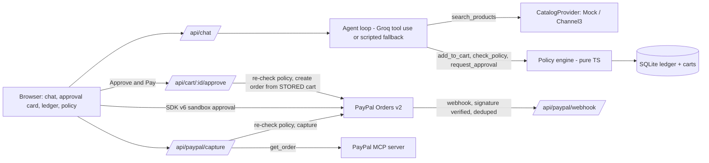

# Errand Agent

An AI shopping agent with spending guardrails that checks out through PayPal.

**The LLM proposes, the policy engine decides, the human approves, the server charges.**
The agent has no tool that can pay or capture. Every decision lands in a live ledger.

> Status: unit tests (18/18) and the production build pass. The PayPal sandbox checkout (popup, approve, capture, ledger) has been run end to end on the author's machine. Not yet verified: webhook delivery, the hosted Render deploy and the optional Channel3 catalog. The agent uses Groq when GROQ_API_KEY is set and falls back to a scripted agent otherwise. Policy checks, approval, payment and the ledger are the same real code in both modes.

## Run it in under 10 minutes
1. Node 22.13+ (uses Node's built-in SQLite, so there is no native build step). `git clone <repo> && cd errand-agent && cp .env.example .env`
2. Create sandbox credentials (next section) and fill `.env`, plus `GROQ_API_KEY` and `GROQ_MODEL` (optional: leave `GROQ_API_KEY` empty to use the scripted agent).
3. `npm install && npm run dev`, open http://localhost:3000.
4. Click an example prompt. For the happy path, press **Approve & Pay** and log in with the sandbox *personal* (buyer) account.
5. `npm test` runs the unit and flow tests (no network or keys needed; PayPal is mocked).

## Sandbox setup
1. https://developer.paypal.com > **Testing Tools > Sandbox Accounts**. Use the default Business (seller) and Personal (buyer) accounts, or create them. Open the buyer account to copy its email and password; **these are your test buyer credentials**.
2. **Apps & Credentials > Sandbox > Create App**. Copy Client ID and Secret into `PAYPAL_CLIENT_ID` / `PAYPAL_CLIENT_SECRET`. The client ID is served to the browser at runtime from `/api/config`, so no build-time variable is needed.
3. Webhooks (optional but recommended): run a tunnel (`ngrok http 3000` or `cloudflared tunnel --url http://localhost:3000`). In your app add a webhook `https://<tunnel>/api/paypal/webhook` for `PAYMENT.CAPTURE.COMPLETED` and `PAYMENT.CAPTURE.DENIED`, and put its ID in `PAYPAL_WEBHOOK_ID`. Without it, webhooks are rejected (401) and capture still works from the browser callback.

## Architecture

## Where PayPal is used
- **Orders API v2** (`src/lib/paypal.ts`): create (idempotent `PayPal-Request-Id`), capture, get.
- **JS SDK v6** (`src/app/page.tsx`): `createInstance`, `findEligibleMethods`-style flow via `createPayPalOneTimePaymentSession`; the order promise is passed unawaited to `session.start()` as v6 requires.
- **Webhooks** (`/api/paypal/webhook`): verified with `POST /v1/notifications/verify-webhook-signature`, deduped by event id.
- **PayPal Agent Toolkit / MCP server** (`src/lib/paypal-mcp.ts`, called from `/api/paypal/capture`): after a successful capture the server starts the official `@paypal/mcp` server over stdio (`npx -y @paypal/mcp --tools=all`, sandbox token) and calls its `get_order` tool; the result appears in the ledger as `order_status_verified` (actor `agent`). If the MCP server cannot start or returns an error, it falls back to a direct REST lookup and the ledger reason says `rest-fallback`. Note this is a deterministic MCP client call, not the LLM choosing the action: the LLM deliberately has no PayPal tools.

## Where the AI is used
`src/lib/agent.ts`: Tool-use loop over the Groq OpenAI-compatible API (plain fetch, no SDK), with a scripted no-AI fallback. Tools: `search_products`, `add_to_cart`, `check_policy`, `request_approval`. Model from `GROQ_MODEL`.

## Security rules (all covered by `npm test`)
1. Amounts come only from the stored cart (approve ignores the request body).
2. The agent has no pay/capture tool.
3. Orders require status `approved_by_user` + passing policy; policy is re-run at approval and capture.
4. Webhooks are signature-verified and idempotent.
5. Secrets only via env vars.

## Environment variables
| Var | Purpose |
|---|---|
| `PAYPAL_CLIENT_ID`, `PAYPAL_CLIENT_SECRET` | Sandbox REST app |
| `PAYPAL_WEBHOOK_ID` | Webhook verification |
| `PAYPAL_API_BASE` | Defaults to sandbox |
| `GROQ_API_KEY`, `GROQ_MODEL` | Agent (optional: empty key = scripted agent) |
| `CATALOG_PROVIDER` (`mock`\|`channel3`), `CHANNEL3_API_KEY` | Optional live catalog; always falls back to `MockCatalog` |
| `DATABASE_PATH` | SQLite file via `node:sqlite` (default `./data/errand.db`) |

## Catalog
`MockCatalog` seeds 40 products (books, electronics, kitchen, gifts, plus gift cards, alcohol, weapons for the blocked-category demo). `Channel3Catalog` calls `POST https://api.trychannel3.com/v1/search` (`x-api-key`), caches results into the products table, and infers policy categories (gift cards, alcohol, weapons) from titles/categories, so blocked-category rules still apply; the inference is a conservative keyword match, not a guarantee. Channel3 gives no delivery estimate, so `delivery_days` is unknown and the agent is told not to promise dates.

## Deploy on Render
Connect the repo; `render.yaml` is detected. Set the secret env vars in the dashboard. The free-tier disk is ephemeral: data re-seeds on boot, fine for a demo. Register `https://<service>.onrender.com/api/paypal/webhook` as the sandbox webhook.

## Tests
`npm test`: policy rules and boundaries, monthly budget, tamper test, capture/approve guards, webhook replay and bad signature, catalog and Channel3 mapping, "agent has no pay tool".

## Schema notes
Beyond the spec: `carts.paypal_order_id`, `carts.last_policy_allowed`, a `webhook_events` table (dedupe), and ledger event `order_status_verified`.

## How it was built during the hackathon
Built in milestones with an AI coding assistant, one layer at a time: PayPal flow first, then the pure policy engine with tests, then the agent loop, UI, MCP and catalog integrations. All PayPal, Channel3 and Agent Toolkit calls were written from their current docs.

License: MIT
